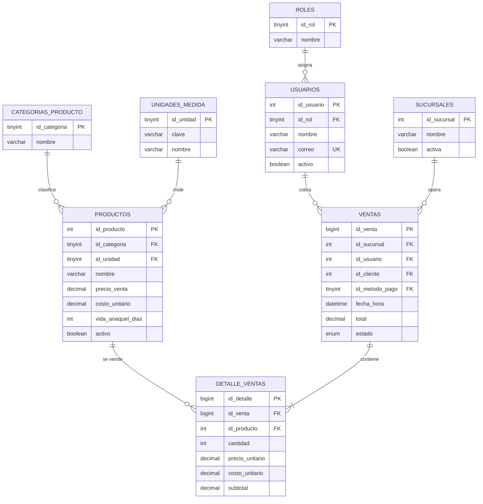
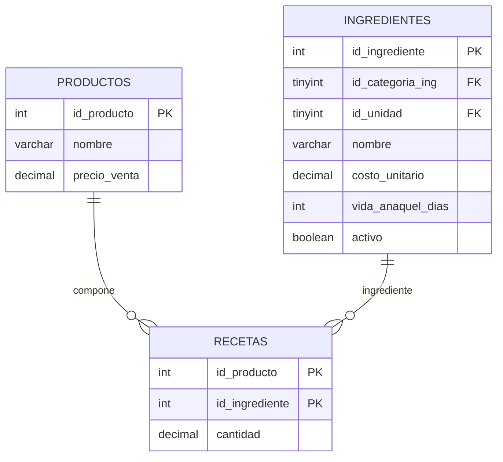
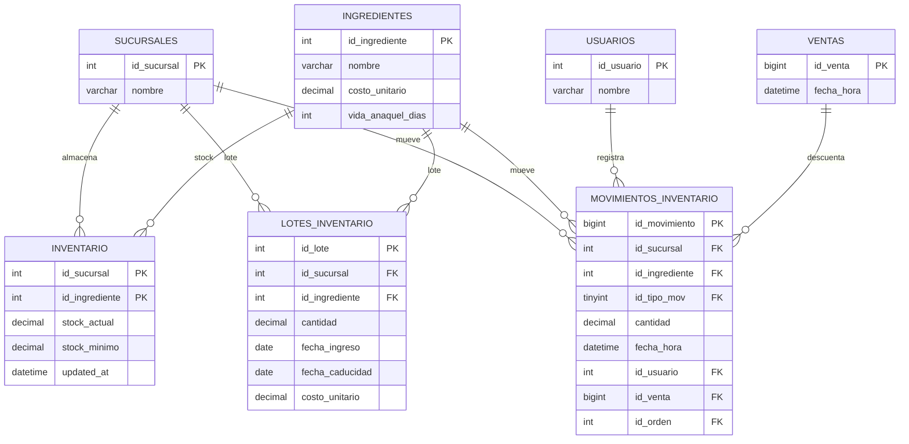
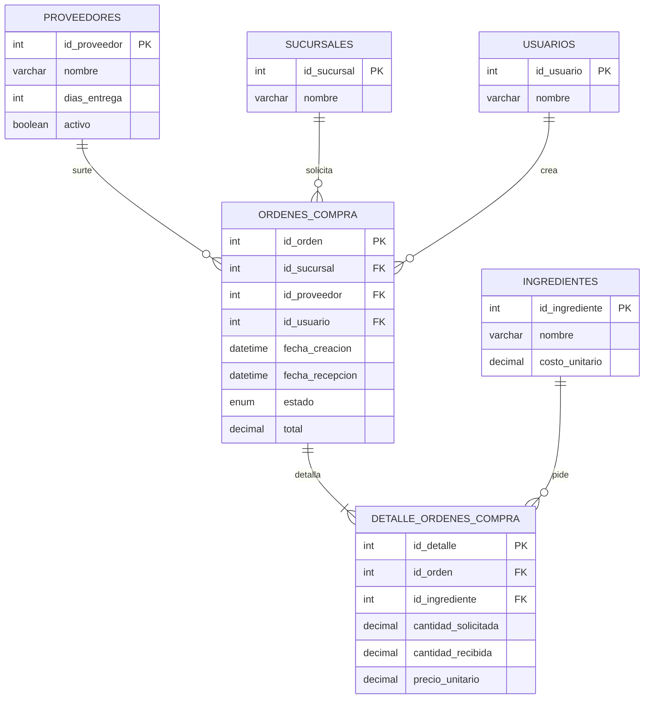
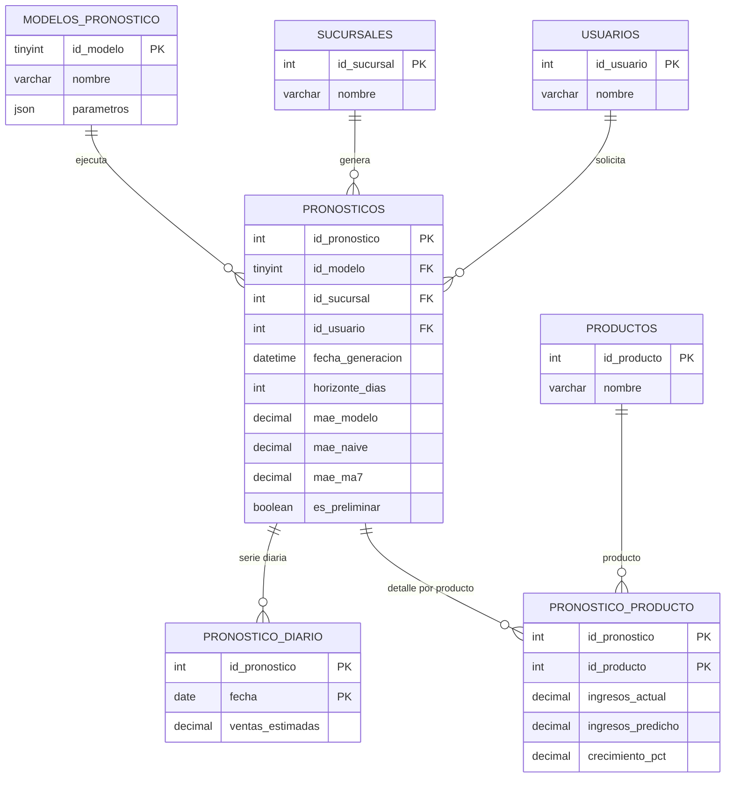

# Diagrama entidad-relación — `frutidata`

Diagrama de las **20 tablas esenciales** para explicar el funcionamiento de la
frutería: 18 del flujo operativo más 2 catálogos de apoyo (`categorias_producto`
y `unidades_medida`). Está dividido en cinco módulos para que cada vista sea
legible; juntos forman el mismo modelo entidad-relación. Una tabla puede
aparecer en más de un módulo para mostrar sus relaciones, pero se cuenta una
sola vez.

> **Cómo leerlo:** `PK` = llave primaria, `FK` = llave foránea, `UK` = valor
> único. Las líneas con `||--o{` significan uno a muchos. Las tablas puente
> (`recetas`, `detalle_ventas`, `detalle_ordenes_compra`) resuelven relaciones
> muchos a muchos.

## 1. Catálogo y ventas

**Qué explica:** una venta es una cabecera (`ventas`) con varios renglones
(`detalle_ventas`). Cada renglón apunta a un producto y guarda el precio y el
costo del momento; así el histórico no cambia si después se actualiza el
catálogo. `clientes` y `metodos_pago` se omiten porque son catálogos opcionales.

## 2. Recetas: productos e ingredientes

**Qué explica:** un producto vendible (por ejemplo, un jugo) consume varios
ingredientes; `recetas` guarda la cantidad de cada insumo por unidad vendida.
Las frutas y verduras que se venden tal cual no necesitan receta.

## 3. Inventario con caducidad

**Qué explica:** `inventario` es el saldo agregado por sucursal e ingrediente;
`lotes_inventario` guarda cada ingreso con su fecha de caducidad (para FEFO);
`movimientos_inventario` es el kardex: entradas, salidas, mermas y ajustes. El
tipo de movimiento (`tipos_movimiento`) se omite como catálogo, pero `id_tipo_mov`
dice si suma o resta.

## 4. Compras y proveedores

**Qué explica:** una orden de compra tiene cabecera (proveedor, sucursal,
usuario, estado) y detalle por ingrediente. Al recibirla, la app actualiza
`inventario`, crea lotes y registra el movimiento en el kardex.

## 5. Pronóstico

**Qué explica:** cada corrida de pronóstico se guarda en `pronosticos` con el
modelo, la sucursal, el usuario, el horizonte y los errores MAE. La serie diaria
va en `pronostico_diario` y el detalle por producto en `pronostico_producto`.

> **Ojo:** estas tablas **guardan** el pronóstico cuando el usuario presiona
> “Guardar”. La simulación de la temporada **no las lee**: recalcula el
> pronóstico en memoria, día a día, con la historia hasta ayer.

## Flujo completo en una frase

`productos` / `ingredientes` → `ventas` / `detalle_ventas` → `inventario` /
`lotes_inventario` / `movimientos_inventario` → `ordenes_compra` /
`detalle_ordenes_compra` → `pronosticos` / `pronostico_diario` /
`pronostico_producto`.

## Tablas omitidas (y por qué)

| Tabla omitida | Motivo |
|---|---|
| `categorias_ingrediente` | Catálogo de una columna; se explica como atributo de `ingredientes`. |
| `clientes`, `metodos_pago` | Catálogos opcionales de la venta; no cambian el flujo de inventario. |
| `historial_precios` | Auditoría de cambios de precio; no participa en la operación diaria. |
| `tipos_movimiento` | Catálogo del kardex (`entrada`, `salida`, `merma`, `ajuste`); se explica como atributo. |
| `bitacora_accesos` | Auditoría de login; no es parte del flujo comercial. |
| `parametros_sistema`, `clima_torreon` | Configuración y referencia; el pronóstico actual no los usa. |
| `ingrediente_proveedor` | Tabla puente de precios por proveedor; se puede mencionar sin dibujarla. |
| `v_*` (vistas) | No son tablas; son consultas de reporte (KPIs, ventas diarias, inventario, Pareto). |
