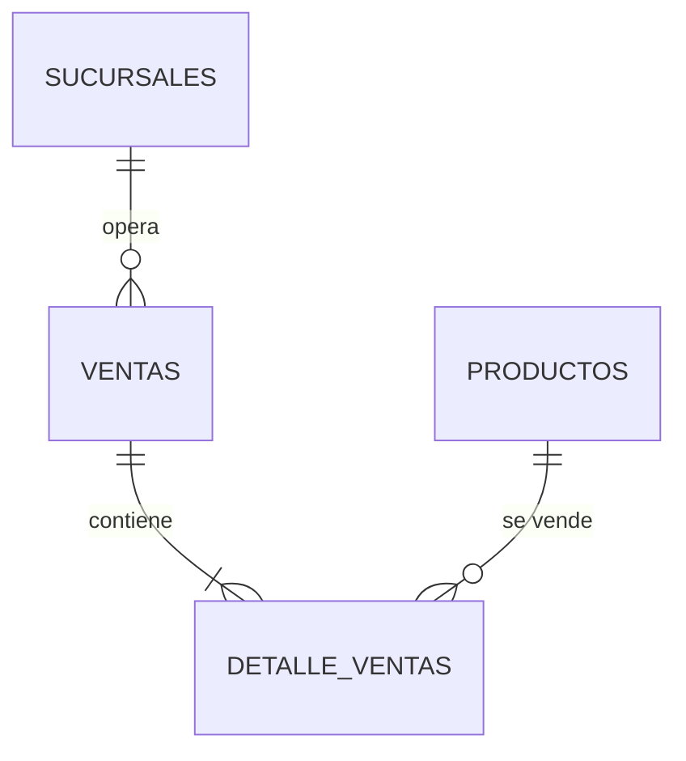
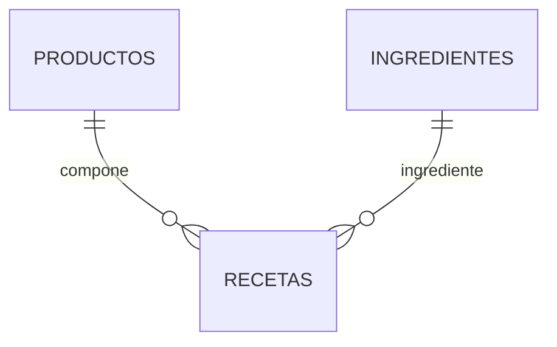
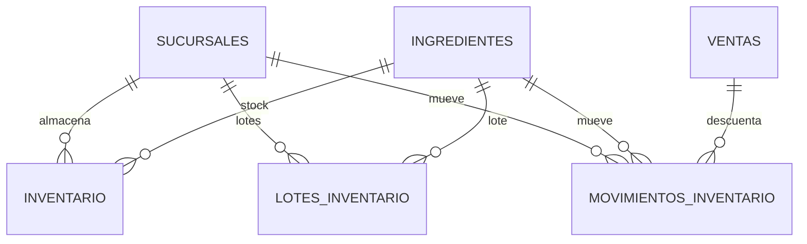
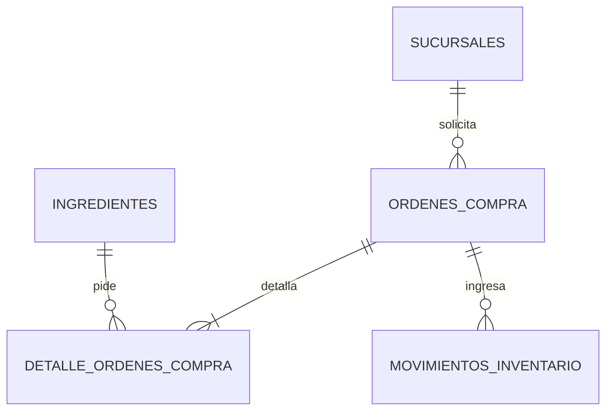
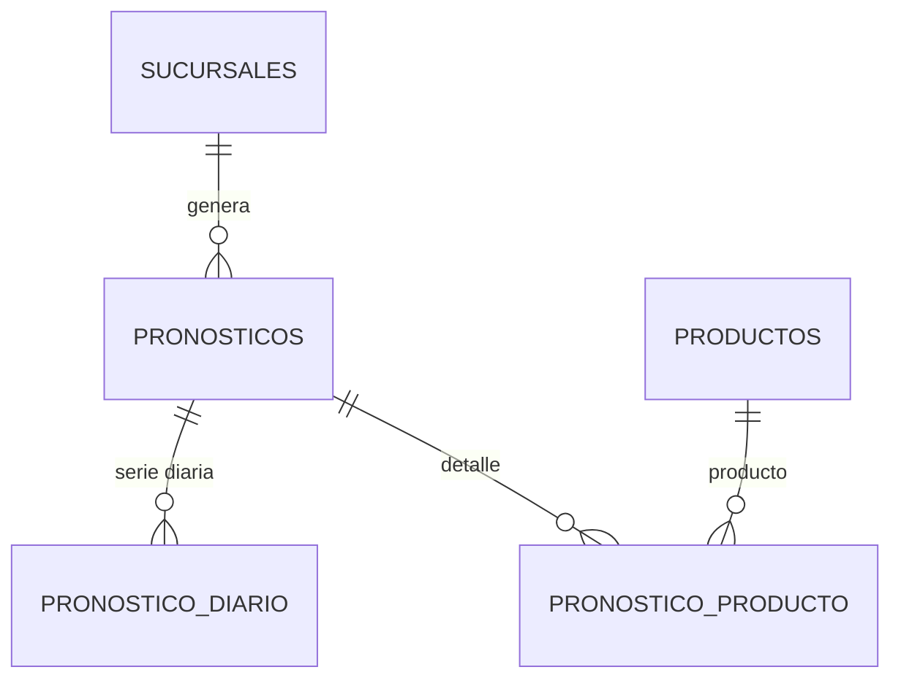

# Diagrama entidad-relación comprimido — `frutidata`

Versión comprimida del ERD: **solo nombres de tablas y relaciones**. No muestra
atributos, llaves ni tipos de dato. Son 14 tablas esenciales, agrupadas en cinco
módulos para que cada vista sea legible. Juntas explican el flujo general y la
ruta de la predicción.

> **Cómo leerlo:** `PK`/`FK` no se dibujan; las líneas indican cardinalidad.
> `||--o{` = uno a muchos · `||--|{` = uno a uno o más. Las tablas puente
> `RECETAS`, `DETALLE_VENTAS` y `DETALLE_ORDENES_COMPRA` resuelven los
> muchos-a-muchos.

## 1. Catálogo y ventas



`PRODUCTOS` es lo que se vende; `VENTAS` es la cabecera y `DETALLE_VENTAS` los
renglones. `SUCURSALES` ubica la operación.

## 2. Recetas



Un producto vendible (por ejemplo, un jugo) consume varios ingredientes;
`RECETAS` guarda la cantidad de cada insumo por unidad vendida.

## 3. Inventario



`INVENTARIO` guarda el saldo por sucursal e ingrediente; `LOTES_INVENTARIO`
guarda cada ingreso con su caducidad; `MOVIMIENTOS_INVENTARIO` es el kardex.

## 4. Compras



`ORDENES_COMPRA` es la cabecera; `DETALLE_ORDENES_COMPRA` pide ingredientes. Al
recibirla se actualiza el inventario y se registra el movimiento de entrada.

## 5. Pronóstico



`PRONOSTICOS` guarda la corrida; `PRONOSTICO_DIARIO` la serie diaria;
`PRONOSTICO_PRODUCTO` el detalle por producto.

## Ruta de la predicción

La predicción se explica con estas tablas:

```text
VENTAS + DETALLE_VENTAS  →  serie diaria de unidades
PRODUCTOS                →  precio, costo y vida de anaquel
PRONOSTICOS              →  cabecera de la corrida
PRONOSTICO_DIARIO        →  serie diaria estimada
PRONOSTICO_PRODUCTO      →  detalle por producto
```

- **Entrada:** de `VENTAS` se toma `fecha_hora` y `estado = 'completada'`; de
  `DETALLE_VENTAS` se toma `cantidad` por `id_producto`. La serie se agrupa por
  día y los huecos se rellenan con 0.
- **Producto:** de `PRODUCTOS` salen `precio_venta`, `costo_unitario` y
  `vida_anaquel_dias`. El precio y el costo alimentan la decisión de pedido; la
  vida de anaquel alimenta la simulación de inventario.
- **Salida:** `PRONOSTICOS` identifica la corrida; `PRONOSTICO_DIARIO` guarda la
  serie estimada; `PRONOSTICO_PRODUCTO` guarda el detalle por producto.
- **Inventario:** `INVENTARIO` y `LOTES_INVENTARIO` no calculan la tendencia;
  se usan para decidir el pedido y simular caducidad.

> La simulación de temporada **no lee** las tablas de pronóstico: recalcula el
> pronóstico en memoria, día a día, con la historia hasta ayer. Las tablas
> `PRONOSTICOS`, `PRONOSTICO_DIARIO` y `PRONOSTICO_PRODUCTO` guardan las
> corridas cuando el usuario presiona “Guardar” en la app.

## Tablas omitidas

Para mantener el diagrama comprimido se omiten catálogos de apoyo, auditoría y
vistas:

- `USUARIOS`, `PROVEEDORES`, `MODELOS_PRONOSTICO`.
- `CATEGORIAS_PRODUCTO`, `CATEGORIAS_INGREDIENTE`, `UNIDADES_MEDIDA`.
- `CLIENTES`, `METODOS_PAGO`, `HISTORIAL_PRECIOS`, `TIPOS_MOVIMIENTO`.
- `BITACORA_ACCESOS`, `PARAMETROS_SISTEMA`, `CLIMA_TORREON`,
  `INGREDIENTE_PROVEEDOR`.
- Las 11 vistas `v_*` (son consultas de reporte, no tablas).

`SUCURSALES` sí se incluye porque ventas, inventario, compras y pronósticos
están separados por sucursal. `PROVEEDORES` se omite para no cargar el diagrama;
la relación de compra se explica con `ORDENES_COMPRA`.
